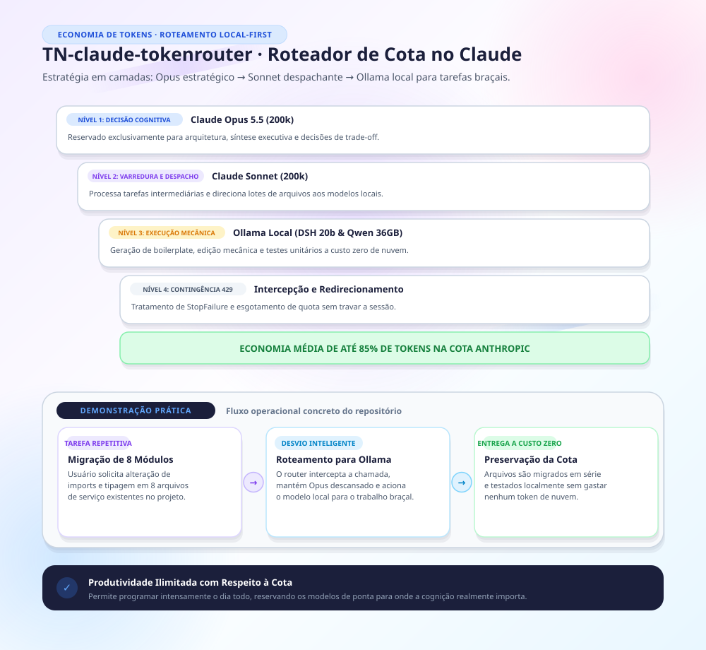

Feito por cópia de repo privado claude-token-router na versão f6bac0e de TN em 11/2026.

---

# token-router — Opus planeja, Sonnet 5.5 comanda

> **Máquina nova?** Siga [`SETUP-MAQUINA-NOVA.md`](SETUP-MAQUINA-NOVA.md) — ordem de
> instalação completa (Git Bash → Python/uv → **Graphify** → plugin → config pessoal).

Plugin do Claude Code para gastar menos tokens: o **Opus mais recente** é o cérebro —
atua só como orquestrador/arquiteto (planeja, delega e sintetiza) — enquanto o
trabalho braçal roda em modelos mais baratos via subagentes.

Para fixar o Opus como modelo principal em todas as sessões, adicione ao
`~/.claude/settings.json`:

```json
{ "model": "opus" }
```

O alias `opus` resolve sempre para a versão mais atual do Opus disponível no CLI —
sem precisar atualizar a config quando sair versão nova. Quem traduz o alias para a
versão concreta é o catálogo de modelos do próprio CLI, então basta manter o app do
Claude atualizado para o cérebro migrar sozinho para o Opus mais recente (5, 5.5, 6, …).
**Não fixe uma versão específica** (ex.: `claude-opus-5-5`): isso quebra o auto-follow.

| Subagente | Modelo | Função |
|---|---|---|
| `token-router:Explore` | Sonnet | Buscar arquivos, localizar código, entender estrutura (somente leitura) |
| `token-router:resumidor` | Sonnet | Ler e resumir logs, docs, saídas longas, arquivos grandes |
| `token-router:executor` | Sonnet | Implementar código a partir de plano já definido |
| `token-router:revisor` | Sonnet | Revisar código recém-escrito (bugs, segurança, testes) |
| `token-router:qwen-local` | Haiku (despachante) | Despachar volume mecânico ao Qwen Code local — custo zero, nada sai da máquina |
| `token-router:dsh-local` | Sonnet (despachante) | Despachar tarefa pequena (1–4 arquivos) sobre dado sigiloso ao DeepSeek Harness local (gpt-oss:20b) — custo zero, segundos; exige ≥13 GB de VRAM livres |
| ~~`token-router:local-rapido`~~ | — | **Arquivado em 30/09/2026** (`docs/local-rapido-arquivado.md`): esqueleto inativo nas três máquinas custava descrição na lista de agentes de toda sessão. Volta para `agents/` quando medido numa estação com VRAM suficiente |

⚠️ **O nome é qualificado pelo plugin.** As cópias em `~/.claude/agents/` foram removidas
em 31/08/2026; `executor` sozinho não resolve mais.

## Hooks de git: a versao nao anda para tras

⚠️ **Rodar UMA VEZ por clone**, logo depois de clonar — `.git/hooks/` nao e
versionado, e clone novo nasce **sem** a barreira, em silencio:

```bash
python scripts/instalar-hooks.py
```

**Por que existe.** Em 31/08/2026 uma sessao concorrente escreveu `1.7.2` por cima de
`1.9.1` no `plugin.json`. Ninguem errou de proposito: ela partiu de um estado anterior do
arquivo e nao viu que a versao ja havia avancado. O conteudo dos commits sobreviveu — o que
se perdeu foi a **monotonia do numero**, e ninguem audita isso. Quem puxa recebe uma versao
menor e o CLI nao ve motivo para atualizar.

Duas barreiras, porque uma so tem furo:

| Hook | Compara | Fecha o furo de |
|---|---|---|
| `pre-commit` | `plugin.json` **staged** contra o `HEAD` | edicao distraida indo ao historico |
| `pre-push` | o que **sobe** contra o **remoto** | commit com `--no-verify`, ou clone sem hook |

⚠️ A comparacao e **numerica, campo a campo**. Comparar como texto seria o proprio bug:
em ordem alfabetica `"1.9.1" > "1.10.0"`, e 1.10.0 e a maior das duas.

Validado contra a regressao real: alimentado com os SHAs de 31/08, o `pre-push` bloqueia;
com os SHAs corrigidos, passa.

## O mapa da hierarquia


[`docs/hierarquia-agentes.svg`](docs/hierarquia-agentes.svg) — SVG autocontido, sem fonte
nem asset externo. Mostra os quatro executores, o gatilho observável de cada ramo, a
fronteira de permissão que separa OpenCode de Qwen Code, e o bastão que os encadeia em série.

**Todo número no desenho foi medido** na máquina Windows em 30–31/08/2026, e o desenho
carrega a data. Estimativa não entra: duas afirmações que estavam ali por intuição
("minutos por tarefa", "o modelo menor é a pista rápida") caíram quando foram medidas.

⚠️ **O diagrama é uma segunda cópia do que `rules/roteamento.md` diz — e cópia envelhece.**
Ao mudar as regras, mude o SVG **no mesmo commit** ou apague-o. Um mapa que descreve o
roteamento de ontem é pior que nenhum mapa, porque parece autoridade.

> **Fonte da verdade do roteamento:** `rules/roteamento.md`. A tabela acima é resumo
> para leitura no GitHub — ao adicionar ou remover um subagente, atualize os dois
> (e o arquivo em `agents/`), senão o agente existe mas nada instrui o modelo
> principal a usá-lo, e a economia some sem nenhum erro aparecer.

As regras de roteamento (`rules/roteamento.md`) são injetadas automaticamente no
início de cada sessão por um hook `SessionStart` — não é preciso editar o CLAUDE.md
de cada máquina.

## Perfis por máquina

Cada máquina tem um perfil em `maquinas/<id>.md`. O script `scripts/perfil-maquina.py`
detecta o perfil no `SessionStart` por variável de ambiente, hostname, plataforma ou VRAM
e o injeta depois das regras de roteamento. Quando divergem, o perfil prevalece.

> **Pré-requisito no Windows: Git Bash.** O hook declara `"shell": "bash"` porque
> a expansão `${CLAUDE_PLUGIN_ROOT}` é sintaxe de shell POSIX. Sem essa declaração,
> o Claude Code cai no PowerShell em máquinas Windows sem Git Bash, onde `${VAR}`
> resolve para vazio — o plugin instalaria com sucesso e **não injetaria nada**,
> sem erro visível. Quem instala pelo marketplace já tem git (e portanto Git Bash).

## Autoatualização dos aplicativos vinculados

Desligada por padrão. Defina `TOKEN_ROUTER_AUTOATUALIZAR=ligado` e reinicie o Claude Code
para verificar atualizações a cada início de sessão, no máximo a cada 6 h, em segundo plano.
O resumo chega na sessão seguinte; apps em uso são pulados e tentados depois.
Consulte sem alterar com `python scripts/atualizar-vinculados.py --verificar` ou atualize
imediatamente com `--agora`. Log: `~/.claude/token-router/autoatualizacao.log`.
Inclui plugin, Qwen, OpenCode, DSH e Ollama.
Veja como ligar e desligar e os limites em [rules/roteamento.md](rules/roteamento.md#autoatualização-dos-aplicativos-vinculados-interruptor-23092026).

## Instalar em qualquer máquina (Code ou Cowork)

Com o repositório publicado no GitHub (ex.: `local-user/claude-token-router`):

```
/plugin marketplace add local-user/claude-token-router
/plugin install token-router@local-user-plugins
```

Pronto — agentes e regras valem para **todos os projetos** dessa máquina.
Para atualizar depois de mudar algo no repo: `/plugin marketplace update local-user-plugins`.

### Requisito obrigatório: Graphify

O roteamento pressupõe o **Graphify** instalado — é ele que responde perguntas sobre
código a partir de um grafo já construído, em vez de o modelo ler arquivo por arquivo.
Sem ele, as regras de "consulte o grafo antes de ler" não têm como ser cumpridas.

```bash
uv tool install graphifyy            # ou: pipx install graphifyy
graphify install --platform claude   # registra a skill /graphify
```

Verificar: `graphify --version` deve responder, e `/graphify` deve aparecer como skill.
Requer Python ≥ 3.12 e `uv` (`winget install astral-sh.uv` no Windows).

## Sessões em nuvem (claude.ai/code)

Sessões web clonam o repositório do projeto e **não leem o `~/.claude` da sua máquina**.
Duas opções:

1. Instalar o plugin na sessão (mesmos comandos acima); ou
2. Versionar os agentes no próprio projeto: copie `agents/` para `.claude/agents/`
   do repositório e o conteúdo de `rules/roteamento.md` para o `CLAUDE.md` do repo.
   Assim qualquer sessão (web, colegas, CI) herda o roteamento.

## Instalação manual (sem plugin)

Copie `agents/*.md` para `~/.claude/agents/` e anexe `rules/roteamento.md` ao seu
`~/.claude/CLAUDE.md`. É exatamente o que já existe na máquina de origem.

> Se o plugin estiver instalado numa máquina que **também** tem as regras no
> `~/.claude/CLAUDE.md`, remova a seção duplicada do CLAUDE.md — o hook já injeta.

## Contingência de créditos: backup com Ollama local

O Ollama (v0.14+) fala nativamente a Messages API da Anthropic, então o Claude Code
inteiro pode rodar em modelos locais quando os créditos acabarem:

1. `ollama pull qwen3-coder:30b` (cérebro/executor local) e `ollama pull qwen2.5-coder:7b` (explore/resumidor).
2. Uma função `claude-local` no perfil do shell define `ANTHROPIC_BASE_URL=http://localhost:11434`,
   `ANTHROPIC_AUTH_TOKEN=ollama` e remapeia os aliases via `ANTHROPIC_DEFAULT_{OPUS,SONNET,HAIKU}_MODEL`,
   e retoma a mesma conversa com `claude --continue`.
3. A função grava um marcador (`~/.claude/ollama-pendente.json`); um hook `SessionStart`
   detecta o marcador na primeira sessão de volta nos modelos Claude e manda o modelo
   principal **revisar todo o trabalho feito pelos modelos locais** antes de seguir.

Os modelos Claude continuam sendo os principais — o local é só para não parar o fluxo.
**Scripts prontos e instalação passo a passo em [`contingencia/`](contingencia/README.md)**
(funções de perfil, hook de revisão, requisito `OLLAMA_CONTEXT_LENGTH=32768` e demais
pegadinhas descobertas no teste de ponta a ponta). Regras: `rules/roteamento.md`.

## Economia extra no Claude Code

- `/model` — para tarefas simples, troque a sessão inteira para um modelo mais barato
  (ex.: `/model sonnet`); volte ao padrão para planejamento.
- Esforço de raciocínio: em `~/.claude/settings.json`, `"effortLevel": "low"` (ou
  env `CLAUDE_CODE_EFFORT_LEVEL=low`) reduz tokens de thinking em tarefas simples.
  Valores: `low`, `medium`, `high`, `xhigh`, `max`.
- Sessões longas: prefira encerrar e abrir sessão nova a arrastar contexto gigante;
  contexto acumulado é reprocessado a cada turno.
